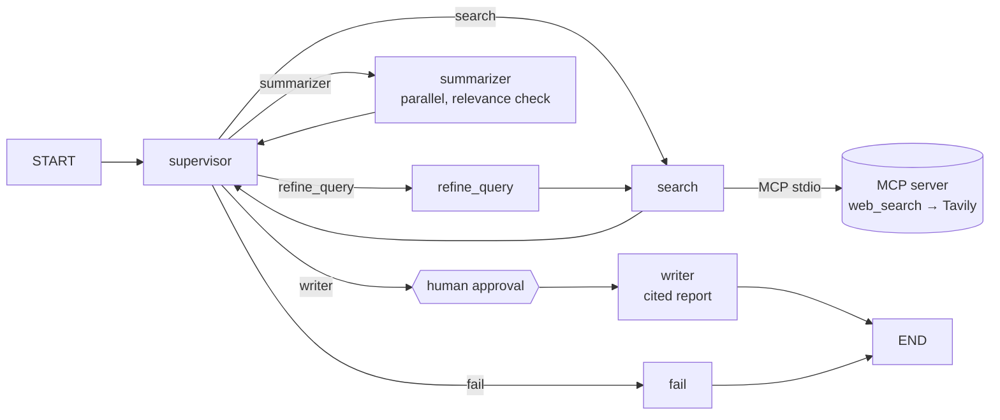
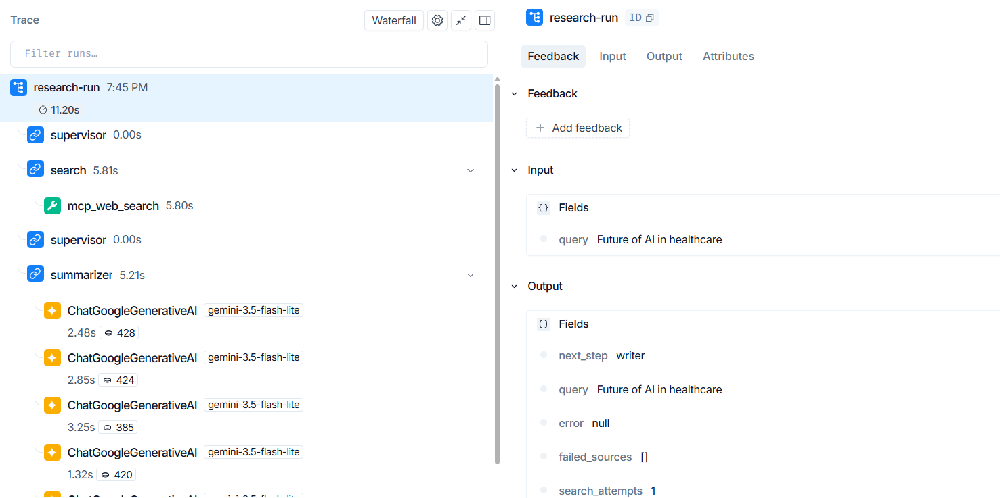
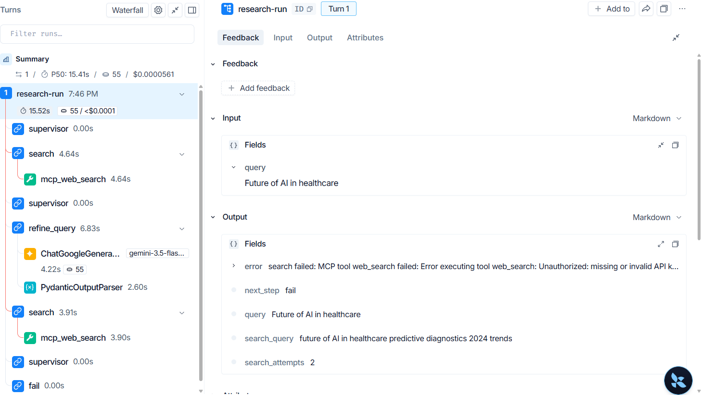

# 🤖 Multi-Agent Research Assistant (v2)

> A LangGraph supervisor agent that researches a topic through its own **MCP search server**, drops off-topic sources, **pauses for human review**, and writes a report whose citations are checked in code.

[](https://python.org)
[](https://langchain-ai.github.io/langgraph/)
[](https://ai.google.dev)
[](https://modelcontextprotocol.io)
[](https://smith.langchain.com)
[](https://streamlit.io)
[](tests/)

🔗 **[Live Demo](#)** &nbsp;|&nbsp; 🎬 **[2-minute video](#)** &nbsp;|&nbsp; 📂 **[GitHub Repo](https://github.com/mansijaysingh/multi-agent-research)**
<!-- TODO (Step 9): replace the two # links with the Streamlit Cloud URL and the YouTube link -->

<!-- TODO (Step 9): add docs/demo.gif (review screen → approve → cited report) -->

---

## 📌 What it does

Type a research topic. The agent:

1. **Searches the web** through an MCP tool it calls over stdio. A supervisor retries with a refined query if too few sources come back.
2. **Summarises every source in parallel**, rejecting sources that are off-topic.
3. **Pauses for you.** You see each source and its summary, can untick any of them, and approve.
4. **Writes a cited report** (Introduction, Key Findings, Conclusion). Every `[n]` is checked against the sources, and the Sources list is built from real search results, never by the model.

If nothing relevant is found, it ends with a clear message instead of a made-up report.

---

## 🧠 Architecture



The **supervisor is a hub**: every worker returns to it, and it picks the next step from the state. The graph is compiled with a `MemorySaver` checkpointer and `interrupt_before=["writer"]`, so a run pauses after summarising. Approving resumes it from the checkpoint, **without searching or summarising again**.

### Routing rules

`decide(state)` is a pure function with no LLM call, checked top to bottom:

| Condition | Next step |
|---|---|
| no search yet | `search` |
| fewer than 3 sources and attempts left (max 2) | `refine_query` → `search` |
| no sources at all | `fail` |
| summarizer hasn't run | `summarizer` |
| every source was off-topic or failed | `fail` |
| otherwise | `writer` (after human approval) |

**Why rules and not an LLM router?** The decision is fully determined by the state, so rules are predictable, free, and **fully unit-tested** (`tests/test_routing.py`). Those tests caught an infinite loop in the original design: with 1–2 sources and no attempts left, the run went back to the summarizer forever. The LLM is used only where language is needed: rewriting a weak query, summarising, writing and judging.

Loops can't run away. There are at most 2 searches, a refine always leads to a search (which counts an attempt), and LangGraph's `recursion_limit` is a final safety net.

---

## 🔌 MCP search server

Web search isn't called directly by the agent. It's a tool on a separate **MCP server** (`mcp_servers/search_server.py`, FastMCP), started as a subprocess over stdio by `mcp_client/client.py`:

| Tool | Input | Output |
|---|---|---|
| `web_search` | `query: str`, `max_results: int = 5` (limited to 1–10) | `{"results": [{"title", "url", "content"}]}` |

- **Why a server:** any MCP client can use the same tool (Claude Desktop, the MCP Inspector, another agent), and adding tools doesn't touch the agent.
- **Errors:** the tool *raises* errors (empty query, missing key, Tavily failure). The client turns them into `RuntimeError("MCP tool web_search failed: …")`, and the UI shows them in red.
- **Try it by hand:** `mcp dev mcp_servers/search_server.py` opens the MCP Inspector (needs Node.js).
- **Trade-off:** each search starts a subprocess. The round trip, including Tavily, is about 4–6 s in traces. A long-lived session is the obvious next optimisation.
- Pinned to MCP SDK 1.x (1.30.0): version 2 renamed the core classes.

---

## 📝 Citations and human review

- Summaries are numbered `[1] Title: summary`, and the writer must cite `[n]` after every claim.
- **Invalid citations are removed in code**: any `[n]` that isn't a summarised source.
- **The Sources list is built from state**, so the model can't invent URLs. If the model writes its own references list anyway, it's cut off.
- In the review screen you can **untick sources**. The edit is written back with `update_state(..., as_node="supervisor")`, so unticked sources disappear from both the citations and the Sources list.
- Each browser session gets its own `thread_id`, and the page is drawn from the checkpoint, so Streamlit's reruns don't lose the paused run.

---

## 📊 Evaluation

`python -m evals.run_eval` runs the full graph (with automatic approval) on **15 topics** in 4 categories, scores each report and writes [`evals/results.csv`](evals/results.csv). The method, every report and the honest reading are in [`evals/notes.md`](evals/notes.md).

**Results** (Gemini 3.5 Flash-Lite as both agent and judge):

| Group | Topics | Completed | Report | Clean fail | Crash | Citation coverage | Groundedness | Latency (median / max) |
|---|---|---|---|---|---|---|---|---|
| **All** | 15 | **100%** | 93% | 7% | 0 | **0.96** | **0.99** | **26.1 s** / 40.2 s |
| broad | 5 | 100% | 100% | 0% | 0 | 0.93 | 1.00 | 34.1 s |
| recent | 4 | 100% | 100% | 0% | 0 | 0.97 | 1.00 | 27.6 s |
| niche | 3 | 100% | 100% | 0% | 0 | 1.00 | 0.97 | 26.1 s |
| vague | 3 | 100% | 67% | 33% | 0 | 1.00 | 1.00 | 19.7 s |

- **Completed:** the run ended with a report *or* a clean "no relevant sources" message. A crash doesn't count.
- **Citation coverage:** the share of Key Findings sentences with at least one `[n]`, using a heuristic sentence split.
- **Groundedness:** the share of cited claims an LLM judge rates as supported by the cited notes, with one judge call per report. **Sanity check:** given 4 real claims and 2 planted false ones, the judge accepted the real ones and rejected both false ones.
- **Cost:** about **$0.004 per report** at paid Flash-Lite prices ($0 on the free tier); the whole 15-topic eval would cost about $0.07.

**What the eval changed.** The first run scored perfectly, including a nonsense topic (`qwxz plorbt vrenk`) that produced a [confident, fully cited report about the film *Point Break*](evals/before_relevance_check/14.md). The metrics checked the report against its *sources*, not against the *question*. Adding a relevance check to the summarizer, in the same call and at no extra cost, **turned that report into a clean fail**, and dropped 12 of 75 sources as off-topic across the set.

**Refine path, forced** (`--max-results 2` on the 3 niche topics): the refine ran 3/3 times, and the second search added +2, +2 and +1 sources. In one case the refined query drifted and both new sources were rejected as off-topic.

---

## 🔭 Tracing (LangSmith)

Every run is traced. The nodes and Gemini calls are traced automatically, and the MCP call is its own `tool` step (`@traceable`), so each trace shows how long the search, the summaries (tokens and latency per source) and the writer take. The two halves of a paused run are grouped by `thread_id`.



<details>
<summary>A failing run in the same view (wrong Tavily key)</summary>

Both `mcp_web_search` steps fail, the supervisor tries a refined query once, then ends in `fail` with the exact error, instead of crashing or writing an empty report.



</details>

The trace showed that **the writer is the slowest step** (about 17 s for one call). It's also the most expensive, because output tokens cost 8× input on Flash-Lite.

---

## ⚠️ Limitations

- **The relevance check is one yes/no from the same model.** It stops nonsense but is lenient on vague questions, and can occasionally drop a relevant source.
- **The judge is the same model as the writer**, and 15 topics is a small sample. It catches made-up facts, but probably not subtle distortions.
- **Source quality and dates aren't checked.** Vendor content and outdated forecasts can end up in a report.
- **Refine rarely triggers on its own**, because Tavily returns results for almost anything.
- **Paused runs live in memory** (`MemorySaver`), so an app restart loses them, and the app says so. Production would use `SqliteSaver` or Postgres.
- **The public demo uses a shared free-tier key**, with 5 runs per browser session. A new session resets the count, so this only stops casual overuse.
- Numbers are for **Gemini 3.5 Flash-Lite**. The free tier of Gemini 3.8 Flash (20 requests a day) can't run the eval.

---

## 🛠️ Tech stack

| Component | Technology |
|---|---|
| Agent framework | LangGraph 1.1 (supervisor hub, conditional edges, checkpointer, interrupt) |
| LLM | Google Gemini 3.5 Flash-Lite via `langchain-google-genai` |
| Tools | MCP (FastMCP server + stdio client), Tavily web search |
| Observability | LangSmith |
| Tests and evaluation | pytest (52 tests), 15-topic eval with an LLM judge |
| UI and deployment | Streamlit, Streamlit Cloud |

---

## 🚀 Run it locally

```bash
git clone https://github.com/mansijaysingh/multi-agent-research.git
cd multi-agent-research
python -m venv venv
venv\Scripts\activate            # macOS/Linux: source venv/bin/activate
pip install -r requirements.txt
copy .env.example .env           # macOS/Linux: cp .env.example .env; then fill in the keys
```

`.env`:
```env
GOOGLE_API_KEY=...        # https://aistudio.google.com
TAVILY_API_KEY=...        # https://app.tavily.com
LANGSMITH_TRACING=true    # optional
LANGSMITH_API_KEY=...
LANGSMITH_PROJECT=research-agent-v2
```

```bash
streamlit run app.py                       # the app
python -m graph.workflow                   # one run from the command line (approves automatically)
pytest -q                                  # 52 tests; no API calls (only the local MCP subprocess)
python -m evals.run_eval --only 1,2        # evaluate two topics
mcp dev mcp_servers/search_server.py       # inspect the MCP tool
```

---

## 📁 Project structure

```
multi-agent-research/
├── app.py                    # Streamlit UI: start run, review screen, approve, report
├── config.py                 # model name and limits
├── graph/
│   ├── state.py              # AgentState, Source, Summary types
│   └── workflow.py           # the graph: hub routing, checkpointer, interrupt
├── agents/
│   ├── supervisor.py         # decide() rules + supervisor node
│   ├── search_agent.py       # calls the MCP tool, numbers and de-duplicates sources
│   ├── refine_query.py       # Gemini rewrites a weak query (structured output)
│   ├── summarizer_agent.py   # parallel summaries + relevance check
│   ├── writer_agent.py       # cited report; citations checked, Sources built in code
│   └── fail_node.py          # clean final message when nothing usable was found
├── mcp_servers/
│   └── search_server.py      # FastMCP server: web_search → Tavily
├── mcp_client/
│   └── client.py             # stdio MCP client, traced as its own step
├── evals/
│   ├── topics.json           # 15 topics
│   ├── run_eval.py           # runner (batches, merge by id, forced refine)
│   ├── metrics.py            # citation coverage, cited claims (no LLM)
│   ├── judge.py              # groundedness judge
│   ├── results.csv           # results; results_max2.csv = forced refine
│   ├── reports/              # every generated report
│   └── notes.md              # findings, cost, limitations
└── tests/                    # 52 tests: routing, nodes, MCP server, metrics
```

---

## 🧭 Future work

- A stronger relevance filter (Tavily scores, or a separate small check) and a retry with a refined query before failing
- `SqliteSaver` or Postgres checkpointer, so paused runs survive restarts
- A long-lived MCP session (no subprocess per search), and migrating to MCP SDK v2
- A different, stronger model as the judge; a larger evaluation set
- An arXiv search tool on the same MCP server

---

## 🙋 About

Built by **Mansi Singh**, an AI developer specialising in LLM applications, LangChain, RAG and agentic workflows.

[](https://github.com/mansijaysingh)
[](https://linkedin.com/in/mansi-ai)
[](https://mansijaysingh.netlify.app)

---

## ⭐ If you found this useful, give it a star!
